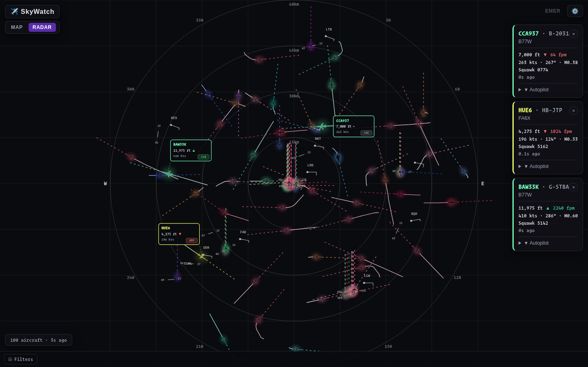
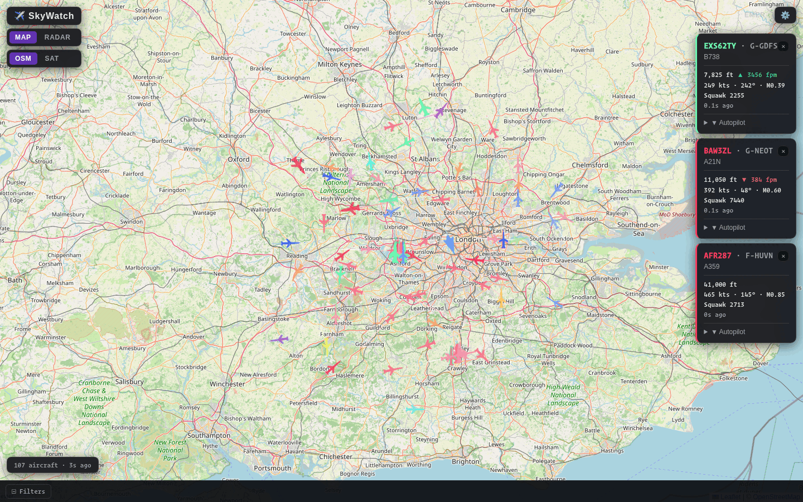

# SkyWatch

[](https://github.com/amir-the-h/skywatch/actions/workflows/ci.yml)
[](LICENSE)

Real-time flight tracker with a map view and a sweep-radar view, powered by public ADS-B data.





## Features

- **Live aircraft** streamed over WebSocket, interpolated client-side between server pushes for smooth motion
- **Two views** of the same data: an interactive Leaflet map (OSM or satellite) and a Canvas 2D sweep radar with zoom and pan
- **Airports** with runway geometry, METAR wind barbs and local wind
- **Emergency alerts** for squawk 7500 / 7600 / 7700 with an optional audio cue
- **Filtering** by flight phase, aircraft type, altitude and more
- **Manufacturer color coding** and zoom/density-aware label decluttering
- **Compass mode** that rotates the radar to the device heading on phones
- **Auto-reload** when a new frontend build is deployed

## Architecture

```
┌─────────────┐   Socket.IO    ┌──────────────┐    HTTP     ┌──────────────────┐
│   Browser   │ ◄────────────► │   Backend    │ ──────────► │  ADS-B API       │
│  React/Vite │                │ Node/Express │             │ adsb.lol,        │
└─────────────┘                └──────┬───────┘             │ airplanes.live,  │
                                      │                     │ or your readsb   │
                                      ▼                     └──────────────────┘
                               ┌──────────────┐
                               │    Redis     │
                               └──────────────┘
```

1. Each client sends `register_location { lat, lon, radiusKm }`. The payload is validated and the radius capped.
2. The backend snaps the location to a ~5 km grid cell. Clients in the same cell share **one** upstream poll.
3. Each active cell is polled round-robin. All configured ADS-B sources are queried in parallel through a shared rate limiter.
4. Results are merged per aircraft (`hex`): live fields come from the highest-priority source, while callsign, registration and route are filled in from lower-priority ones.
5. Aircraft and their path history are cached in Redis, then pushed to each socket filtered to that client's exact radius.
6. METAR, point weather and emergency squawks are polled independently and pushed as separate events.

On the frontend, all state lives in Zustand stores shared by both views.

## Stack

| Layer | Tech |
|-------|------|
| Frontend | React 19, TypeScript, Vite, Zustand |
| Map | Leaflet + react-leaflet |
| Radar | Canvas 2D |
| Backend | Node.js, Express, Socket.IO |
| Cache | Redis |
| Tests | Vitest, Testing Library |
| Container | Docker + Docker Compose |
| Data | [adsb.lol](https://adsb.lol), [airplanes.live](https://airplanes.live), [aviationweather.gov](https://aviationweather.gov), [Open-Meteo](https://open-meteo.com) |

## Quick start (Docker Compose)

```bash
cp .env.example .env   # optional: adjust sources, ports, backend URL
docker compose up -d --build
```

Open http://localhost:8080. The backend listens on port 3001.

`VITE_BACKEND_URL` is baked into the frontend at build time. If you serve SkyWatch from another host, set it to the backend URL the browser should use.

## Running locally

**Prerequisites:** Node.js 22+, Redis (or Docker)

```bash
npm install
(cd backend && npm install)

docker run -d -p 6379:6379 redis:7-alpine

# terminal 1: backend
cd backend && REDIS_URL=redis://localhost:6379 npm run dev

# terminal 2: frontend
VITE_BACKEND_URL=http://localhost:3001 npm run dev
```

Open http://localhost:5173, then set your location and radius in Settings.

## Configuration

Backend environment variables:

| Variable | Default | Description |
|----------|---------|-------------|
| `ADS_SOURCES` | `https://api.adsb.lol/v2/point` | Comma-separated ADS-B base URLs, highest priority first (`ADS_SOURCE` is accepted as an alias) |
| `POLL_INTERVAL_MS` | `1000` | Tick interval of the cell poller. A tick is skipped while the previous poll is still running. |
| `ADS_REQUEST_GAP_MS` | `1100` | Minimum gap between any two upstream ADS-B requests |
| `EMERGENCY_POLL_INTERVAL_MS` | `10000` | How often squawk 7500/7600/7700 are polled |
| `MAX_RADIUS_KM` | `500` | Largest radius a client may request |
| `REDIS_URL` | `redis://localhost:6379` | Redis connection string |
| `PORT` | `3001` | Backend port |
| `LOG_POLL_INTERVAL` | `30` | Log one poll summary every N polls per cell |

Frontend (build time):

| Variable | Description |
|----------|-------------|
| `VITE_BACKEND_URL` | Backend URL the browser connects to |

### ADS-B sources

Any readsb-compatible `/v2/point/{lat}/{lon}/{radiusNm}` endpoint works:

- **adsb.lol** (default): `https://api.adsb.lol/v2/point`
- **airplanes.live**: `https://api.airplanes.live/v2/point`. API access may need prior approval from airplanes.live; unapproved clients get HTTP 403.
- **Your own receiver**: an RTL-SDR dongle running [docker-adsb-ultrafeeder](https://github.com/sdr-enthusiasts/docker-adsb-ultrafeeder); point `ADS_SOURCES` at its readsb API

Please respect each provider's usage policy. The community feeds are free and run by volunteers.

## Development

```bash
npm run dev         # frontend dev server with HMR
npm test            # frontend unit tests
npm run lint        # ESLint
npm run typecheck   # TypeScript project build
npm run build       # production build

cd backend
npm test            # backend unit tests
npm run typecheck
```

CI runs all of the above on every push and pull request.

## License

[MIT](LICENSE)
